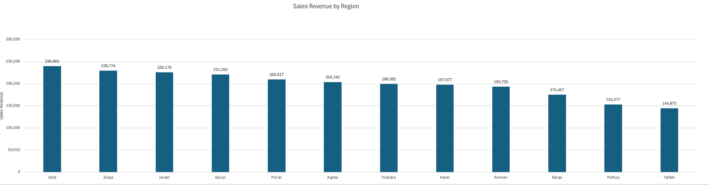
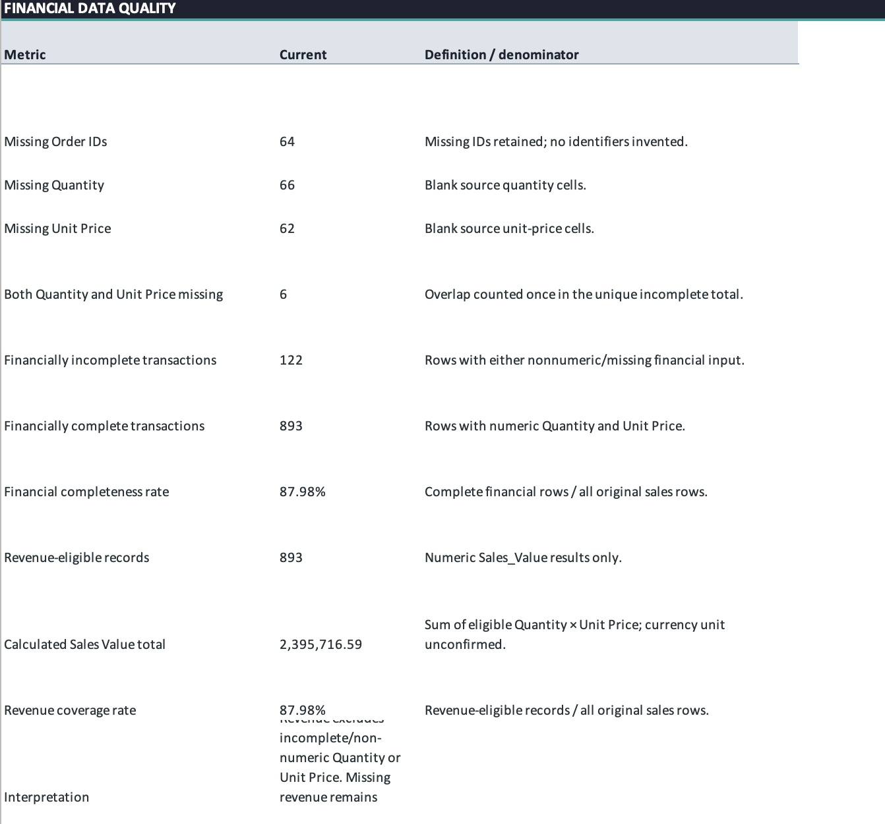
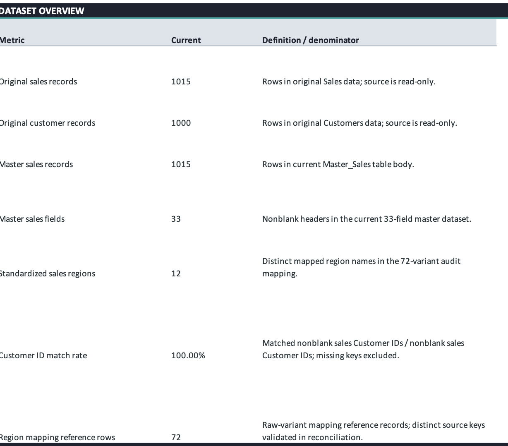

# Jordan Sales & Customer Data Analysis | Excel Portfolio Project 2

**Excel data cleaning · Data-quality audit · PivotTables · Interactive dashboard · Descriptive sales analysis**

> **Publication note:** The underlying workbook has not been included in this public-ready package because its customer data may be personally identifying and redistribution rights are unconfirmed. The source workbook must be sanitized and validated before publication. Amounts are shown without a currency symbol because the currency has not been verified.

## Project overview

This Excel portfolio case study analyzes sales transactions and their related customer records, with an emphasis on transparent handling of incomplete financial inputs, inconsistent categorical labels, and questionable shipping dates. The analysis preserves incomplete rows rather than imputing unknown values or deleting them.

## Business questions

- Which Jordanian sales regions contribute the most calculated revenue?
- How do region-level transaction volumes and eligible average transaction values compare?
- How does revenue vary by month, product category, provider, and customer?
- How much of the source data is financially complete, and what limits reliable reporting?

## Dataset and verified reported results

| Metric | Result |
|---|---:|
| Source sales rows | 1,015 |
| Customer records | 1,000 |
| Master sales fields | 33 (10 original + 23 added) |
| Revenue-eligible sales rows | 893 |
| Financially incomplete sales rows | 122 |
| Financial completeness | 87.98% |
| Calculated sales value (currency unconfirmed) | 2,395,716.59 |
| Standardized sales regions | 12 |
| Date range | 8 Sep 2025 – 7 Sep 2026 |

These results are based on workbook analysis and the supplied Excel audit/documentation. The final publication workbook and its formula behavior require review when a sanitized workbook is available.

## Featured findings

- **Irbid** leads the 12 regions with **239,863.46** (10.01% of calculated sales value); **Tafileh** is lowest with **144,972.59** (6.05%).
- **May 2026** has the highest recorded monthly sales value at **263,015.96**; the September boundary months are incomplete.
- **Electronics** has the highest cleaned category value (**430,050.14**). The unknown category group contributes **174,441.19**.
- **Safeway** leads the cleaned provider grouping at **431,724.86**; the unknown provider group contributes **167,000.63**.
- **509** shipping dates precede order dates. Delivery-speed performance cannot be inferred from this dataset without correcting the underlying date semantics.

## Workbook architecture

The workbook was organized around a traceable workflow from source to reporting:

| Stage | Worksheets / objects | Purpose |
|---|---|---|
| Original data | `Sales`, `Customers` | Preserve raw 1,015 sales rows and 1,000 customer records |
| Preparation | `Sales_Working`, `Customers_Working` | Identify missing fields, look up customer attributes, validate keys and standardize text |
| Reference mappings | Region, category and provider mapping sheets | Normalize defensible variants while preserving raw labels |
| Analytical model | `Master_Sales` / `tbl_MasterSales` | 33 fields covering 10 source fields and 23 derived/lookup/quality fields |
| Exploration | `Sales_Analysis`, additional analysis and customer-ID analysis | Revenue comparisons, row/order counts, category/provider/customer analyses |
| Presentation | `Executive_Dashboard`, `Business_Insights` | KPI cards, charts, dashboard filters and evidence-based interpretations |
| Audit | `Data_Quality_Summary`, `Workbook_Audit`, `Requirements_Checklist` | Document source problems, reconciliations and implementation status |

### Metric definitions

- **Calculated sales value:** `Quantity × Unit_Price` only when both fields are numeric; unknown amounts remain blank.
- **Transaction rows:** all 1,015 sales records, whether or not an order identifier exists.
- **Known orders:** nonblank source Order IDs, not equivalent to transaction rows; repeated IDs may represent multiple records.
- **Average eligible row value:** sum of calculated sales values divided by 893 eligible rows (not all 1,015).
- **Financial completeness:** 893 / 1,015 = 87.98%.
- **Shipping checks:** 509 negative sequences, 427 durations over a *provisional* 30-day review threshold, and 79 within 0–30 days. They are data-quality counts, not certified delivery performance.

## Methods and tools

Microsoft Excel; structured Tables; `IF`, `AND`, `ISNUMBER`, `SUM`, `COUNTIF`/`COUNTIFS`, `XLOOKUP`, `TRIM`, `UNIQUE`, and lookup/mapping workflows; PivotTables; standard charts; formula-driven Region/Month dashboard filters. The workflow was AI-assisted; no Power Query work was verified.

Revenue is calculated as `Quantity × Unit_Price` **only where both values are numeric**. All 1,015 transaction rows remain in the dataset. The 122 financially incomplete records have blank calculated revenue, not zero. Revenue averages use the 893 eligible rows rather than all 1,015 rows.

## Project visuals

Four screenshot files are included in the repository. The three aggregate-analysis images below do not need customer-level labels to communicate the findings.

| Screenshot | What it demonstrates |
|---|---|
| [Regional revenue](assets/regional_revenue.png) | Calculated sales value by 12 standardized governorates, with region ranking |
| [Dataset quality overview](assets/data_quality_overview.png) | Source row counts, master-table structure, customer match and mapping coverage |
| [Financial data quality](assets/financial_data_quality.png) | Missing inputs, eligible records, financial completeness and reconciled sales value |
| [Executive dashboard](assets/dashboard_overview.png) | Six reported KPI cards and five reported visuals; **customer labels in this image require manual privacy review before sharing or featuring publicly** |

### Data-quality overview

### Regional revenue

### Financial completeness

The dashboard screenshot is linked in the table rather than embedded as a featured image until its customer labels are verified safe to disclose. All screenshots represent the actual Excel workbook, not synthetic graphics.

## Limitations

- Missing financial inputs mean the calculated revenue total does not represent all transactions.
- Currency, tax treatment, and discount basis are unknown.
- 64 Order IDs are missing; 3 exact repeated source-row pairs were retained for review.
- 63 category values and 65 provider values are blank in the original sales source.
- Sales-region variant mappings require business-owner semantic review.
- Shipping duration contains 509 negative date sequences; a 30-day screen is provisional, not a delivery SLA.
- The source dataset contains names, identifiers, phone numbers, ages, and locations. Publication of the original workbook is **not approved** by this package.

## Repository guide

| File | Description |
|---|---|
| [Project report](docs/PROJECT_REPORT.md) | Business context and findings |
| [Data dictionary](docs/DATA_DICTIONARY.md) | Original and derived fields |
| [Cleaning log](docs/DATA_CLEANING_LOG.md) | Preparation and quality decisions |
| [KPI definitions](docs/KPI_DEFINITIONS.md) | Metric formulas, denominators, caveats |
| [Business insights](docs/BUSINESS_INSIGHTS.md) | Interpreted findings and recommendations |
| [Quality assurance report](docs/QUALITY_ASSURANCE_REPORT.md) | Tests, reconciliations, known limits |
| [Requirements compliance](docs/REQUIREMENTS_COMPLIANCE.md) | Assignment checklist status |
| [Publication checklist](docs/GITHUB_UPLOAD_CHECKLIST.md) | Required release checks |
| [Manifest](docs/PROJECT_MANIFEST.md) | Actual delivered file inventory |

## Reproducibility

A finished, public-safe Excel workbook is not included. The full workflow requires access to authorized source sheets, transformation formulas, mapping tables, and Excel workbook objects. The described Region/Month dropdown filters are not native slicers. Without the original workbook, this repository documents the method and results but does not yet contain an independently runnable spreadsheet artifact.

## Status

**Four screenshots and the documentation are published. The full Excel workbook is not published pending privacy and redistribution review.** See [publication checklist](docs/GITHUB_UPLOAD_CHECKLIST.md).
